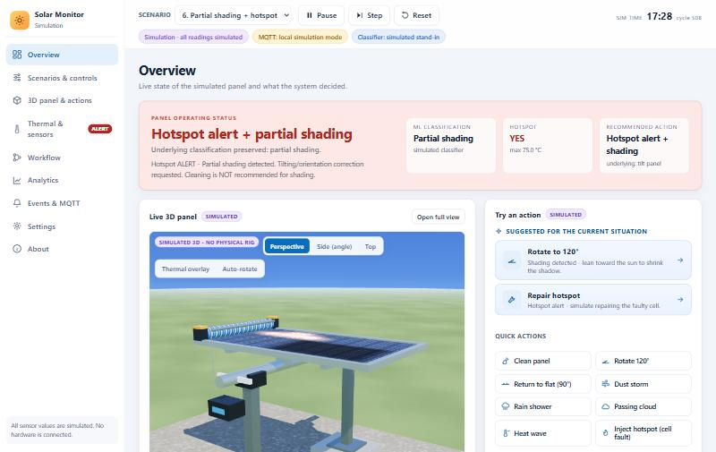
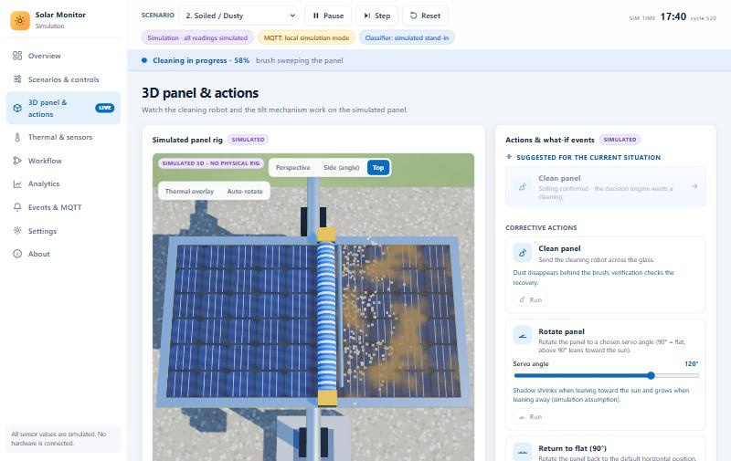
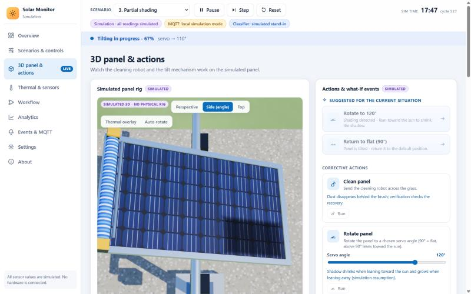
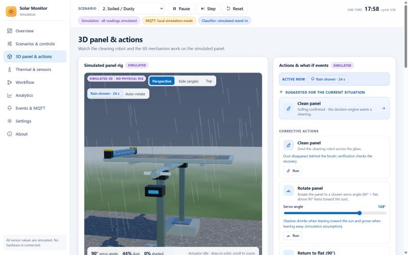
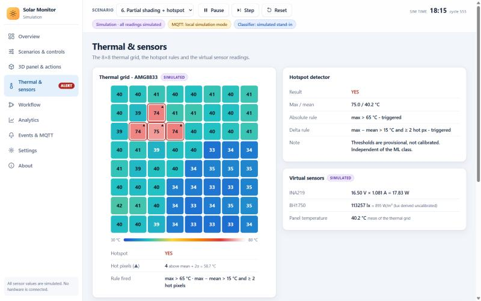
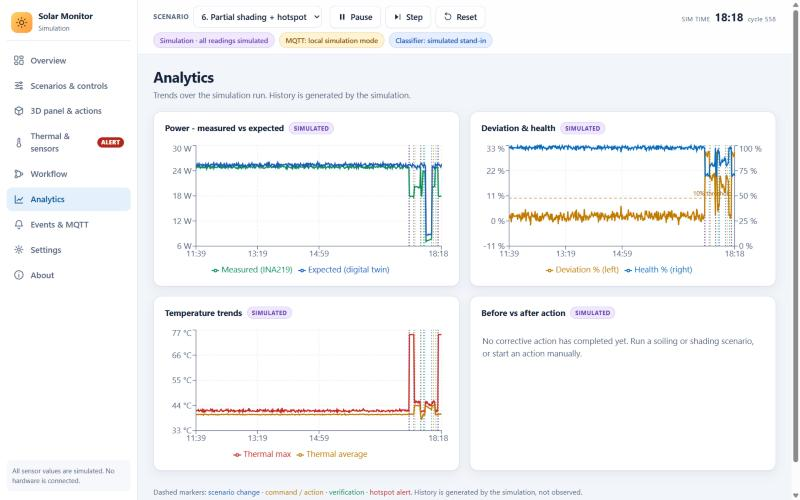

# Solar Panel Monitoring - Software Simulation

**Intelligent Solar Panel Monitoring, Self-Adaptive Cleaning and Predictive Fault Diagnosis using IoT and Machine Learning.**

A complete, interactive, **software-only** demonstration of the whole workflow: virtual sensors, ML classification, rule-based hotspot
detection, digital-twin power comparison, a decision engine, simulated cleaning / tilting with post-action verification, and MQTT
messaging - with a realistic 3D view of the panel. It runs entirely on a laptop (no hardware, cloud account or Docker).

> Every sensor reading, the I-V curve, the cleaning / tilt recovery and the history are **simulated** and labelled as such in the UI.
> The ML classifier is a clearly labelled simulated stand-in until the trained model files are added (see [Plug in the trained model](#plug-in-the-trained-model)).

```
Virtual sensors -> feature preparation -> ML classification -> hotspot detection
   -> expected-performance comparison -> decision engine -> corrective action -> post-action verification
```

## Screenshots

**Overview** - status banner, live 3D panel, suggested actions, pipeline and events. A hotspot alert never erases the ML class.



**Cleaning in 3D** - the brush sweeps the glass with spray; dust disappears behind it (top view).



**Tilting in 3D** - the panel rotates on its pivot while the shadow shrinks.



**What-if events** - rain washing dust off while the light dims. Also: dust storm, passing cloud, heat wave, time of day, shadows, hotspots.



**Thermal grid and hotspot rules** - the 8x8 AMG8833 simulation with the pixels that fired the rule.



**Analytics** - measured vs expected power, deviation and health, temperature, with markers for actions and alerts.



## Quick start (Windows)

Prerequisites: **Python 3.10+**, **Node.js LTS** (only to build the frontend) and **Git**.

```bash
git clone https://github.com/TharunvenkateshN/Solar_panel.git
cd Solar_panel/solar_monitor
setup.bat      # one time: installs Python packages, builds the frontend (needs internet once)
start.bat      # runs the app and opens http://localhost:8000
```

Equivalent manual steps:

```bash
cd solar_monitor
python -m pip install -r requirements.txt
cd frontend && npm install && npm run build && cd ..
python run.py            # then open http://localhost:8000
```

After setup the demo works fully **offline**. Check the install with `python -m pytest -q` (129 tests).

### Optional: real MQTT broker

Without a broker the app shows **"MQTT: local simulation mode"** and delivers messages in-process. To use a real broker, install
[Mosquitto](https://mosquitto.org/download/) and run, from `solar_monitor/mosquitto`:

```bash
"C:\Program Files\mosquitto\mosquitto.exe" -c mosquitto.conf -v
```

The header turns green (*MQTT broker live*) as soon as it connects - start it before or after the app. Topics:
`solar/panel/data`, `status`, `command`, `feedback`. Environment variables: `MQTT_HOST`, `MQTT_PORT`, `MQTT_ENABLED=0`, `PORT`, `SOLAR_CLASSIFIER=auto|simulated|model`.

### Plug in the trained model

Copy `solar_panel_condition_model.joblib`, `model_metadata.json` and `feature_schema.json` (written by the notebook) into
`solar_monitor/backend/models/`, install the scikit-learn version used for training (`pip install scikit-learn==1.6.1`), then press
**Reload model** in *Settings* (or restart). No code changes. Details: [`solar_monitor/backend/models/README.md`](solar_monitor/backend/models/README.md).

## Live deployment (Render, free tier)

The repo includes a `Dockerfile` and `render.yaml`. One service runs the whole app (API, WebSocket and the built frontend) on a single URL.

1. Sign in at [render.com](https://render.com) with GitHub and authorise the `Solar_panel` repository.
2. **New +** -> **Blueprint** -> select the repo. Render reads `render.yaml` (Docker, free plan, health check `/api/health`).
3. Click **Apply** and wait for the build (about 5-8 minutes the first time). The URL looks like `https://solar-panel-monitor.onrender.com`.
4. Later pushes to `main` redeploy automatically.

Notes: the free tier sleeps after ~15 minutes idle (the first request then takes 30-60 s and the simulation restarts, since state is in
memory), so open the URL a few minutes before a demo. A public site cannot reach a broker on your laptop, so it runs in the labelled
**local simulation mode** (`MQTT_ENABLED=0`) with the simulated classifier. The API has no login: anyone with the link can change scenarios.
The container reads `HOST` / `PORT` (`run.py` defaults to `127.0.0.1:8000`, so local use is unchanged).

### Optional: frontend on Vercel, backend on Render

Render alone already serves the whole app. To put the **frontend on Vercel** instead (the backend must stay on Render - Vercel cannot host the long-running WebSocket simulation):

1. Deploy the backend on Render first (above) and note its URL, e.g. `https://solar-panel-monitor.onrender.com`.
2. On [vercel.com](https://vercel.com): **Add New -> Project**, import `Solar_panel`.
3. **Root Directory:** `solar_monitor/frontend`. Framework preset **Vite**, build command `npm run build`, output directory `dist`.
4. **Environment Variables:** `VITE_BACKEND_URL` = the Render URL (no trailing slash). Click **Deploy** and note the Vercel URL, e.g. `https://solar-panel.vercel.app`.
5. In the Render dashboard open the service -> **Environment** and add `CORS_ORIGINS` = the Vercel URL (comma-separate several origins). Render redeploys.
6. Open the Vercel URL: the header chips fill in and the 3D view updates. If it says "Connecting to the simulation backend", wait 30-60 s (free-tier cold start).

`VITE_BACKEND_URL` is baked in at build time; change it and redeploy Vercel. Locally and on Render it stays empty (same origin) and CORS stays off.

## Repository layout

| Path | Content |
|---|---|
| `solar_monitor/backend/` | FastAPI app: sensors, hotspot detector, digital twin, decision engine, actuators, MQTT, classifier adapter, events, 129 tests |
| `solar_monitor/frontend/` | React + Vite + Recharts + three.js dashboard |
| `solar_monitor/mosquitto/` | Local broker configuration |
| `Dockerfile`, `render.yaml` | Live deployment on Render |
| `solar_panel_ai_completed.ipynb` | The original notebook the core logic was ported from |
| `docs/screenshots/` | Images used in this README |

Full documentation - architecture, MQTT message formats, every page, what-if events, assumptions and limitations - is in
[`solar_monitor/README.md`](solar_monitor/README.md).

## Implemented vs simulated vs pending

| Component | Status |
|---|---|
| Virtual INA219 / BH1750 / AMG8833 | Simulated |
| Hotspot detector, digital twin, decision engine | Implemented (notebook rules, provisional thresholds, configurable) |
| ML classifier | Simulated stand-in now; trained-model adapter implemented and tested; real model files pending |
| Cleaning, tilting, 3D view, what-if events | Simulated (explicit assumptions, no motor is controlled) |
| Post-action verification | Implemented on simulated readings; it can fail and then says so |
| MQTT | Implemented (paho client, reconnect); verified against an embedded test broker |
| Physical hardware | Pending (later semester) |

## Limitations

- Thresholds (10 % deviation, 3 cycles, hotspot 65 C / 15 C / 2 px) are the notebook's **provisional** values, not experimentally validated.
- The notebook's 3-class model was trained on 7 samples (leave-one-out accuracy 0.29): demonstration only, never a validated accuracy.
- Recovery after cleaning or tilting is a simulation assumption, not a physical experiment.
